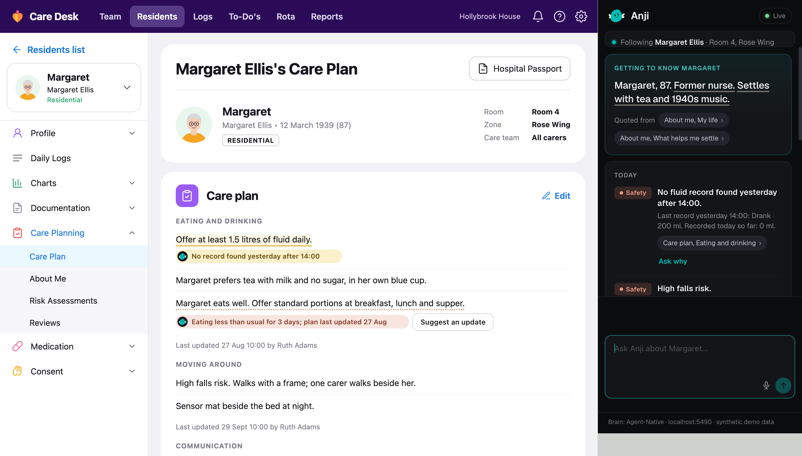
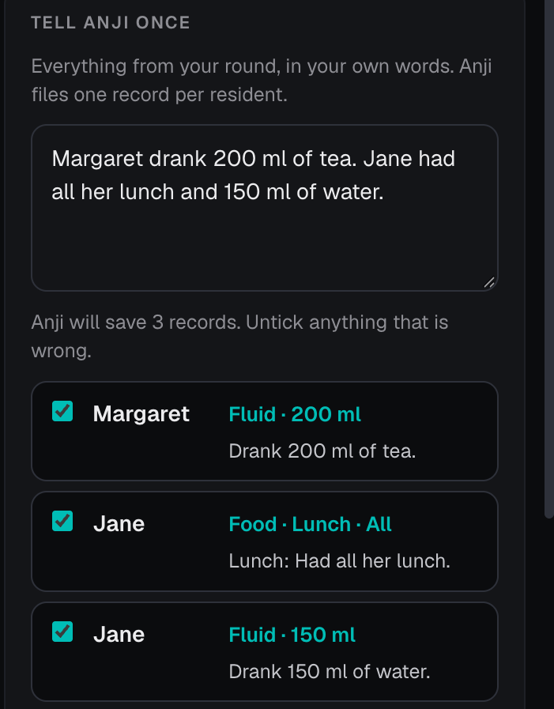
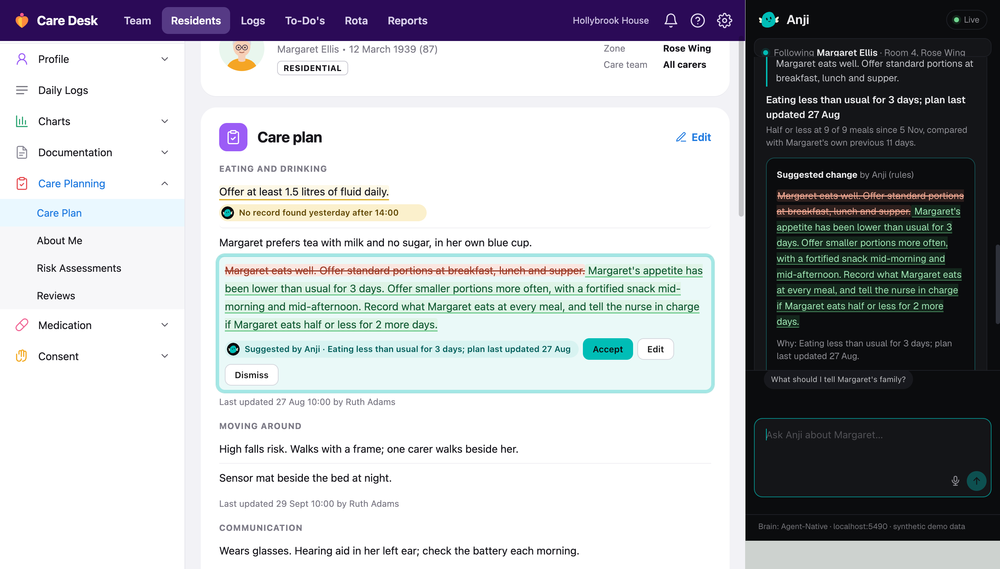
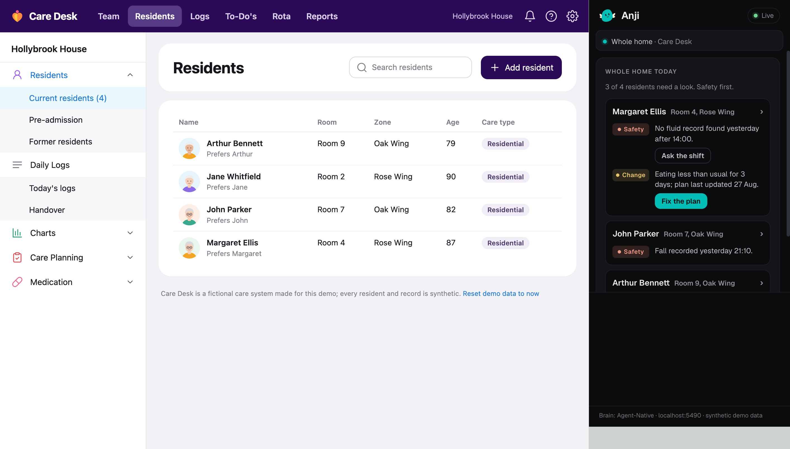
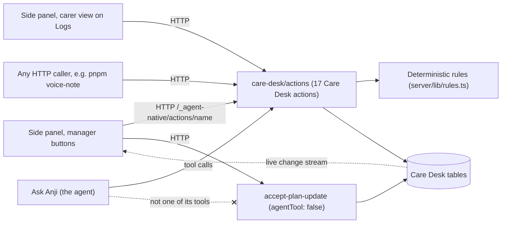

# Anji for Care Desk

**A side panel that reads a care home's records against its care plans, marks
what the records do not back up, and suggests plan changes that only a person
can accept.** Built on [Agent-Native](https://agent-native.com) for the
Builder.io Agent-Native Hackathon (2026).

**Demo video (3 minutes): [watch on Clips](https://clips.agent-native.com/share/9WnsiHG5Bw7H)**. No sign-in needed.



_The panel follows the page. It opens with a line quoted from Margaret's own
About me, then today's points, safety first. On the care plan itself, the fluid
line is underlined "No record found yesterday after 14:00" and the eating line
"Eating less than usual for 3 days; plan last updated 27 Aug"._

**Every resident, staff member, record and the home itself are synthetic.**
Care Desk is a fictional care-record system made for this demo; nothing here
connects to a real care system.

## Three more moments

| Carer: one note, several records | Manager: a plan change as tracked changes | Whole home at a glance |
|---|---|---|
|  |  |  |
| A carer writes one note in their own words. Anji splits it into one record per resident per item and shows them before anything is saved. | Anji drafts new wording when a resident drifts from their own usual and the plan has not caught up. A person accepts, edits or dismisses it. | Only residents with something to look at, safety first, each with **Ask the shift** or **Fix the plan**. |

## What it does

- **Know the person first.** The panel follows the page and opens with one line
  quoted from the resident's own About me, with its source, then three things
  to know today, safety first.
- **Marks the plan, not the person.** Care-plan lines that the records do not
  back up are underlined on the care system's own page ("No record found
  yesterday after 14:00"). Anji says what the records show, never "not done".
- **Live from the floor.** When a carer records a drink over HTTP, the
  manager's underline turns green within a second, without a refresh.
- **Suggests, never decides.** When a resident drifts from their own usual and
  the plan has not caught up, Anji proposes new wording as tracked changes. A
  person accepts, edits or dismisses it.
- **Carer view.** On the shift page (Care Desk's **Logs**) a carer writes one
  note in their own words; Anji splits it into one record per resident per
  item, shows it before saving, and lists what the care plans still expect
  this shift.
- **Whole home at a glance.** On the resident list, only residents with
  something to look at, safety first, each with a one-button "Fix the plan" or
  "Ask the shift".

## How Agent-Native is used: one set of actions, every surface

Every capability is one `defineAction` in [`care-desk/actions/`](care-desk/actions).
The manager's panel buttons, the carer view, the agent ("Ask Anji") and plain
HTTP callers all run the same actions, so the agent, the panel and the page
annotations always agree.



| Action | What it does |
|---|---|
| `get-resident-brief` | "Know them" line from About me, up to three key points, plan checks |
| `get-care-record` | One resident's record as Care Desk shows it |
| `list-residents` | Residents in the demo home |
| `list-observations` | A resident's daily records, newest first, for evidence |
| `list-plan-gaps` | Each checked plan line: gap (no record found), recorded, or drift |
| `home-overview` | Whole home: only residents with something to look at, safety first |
| `log-observation` | Record what a carer observed ("Margaret drank 120 ml of tea") |
| `preview-shift-note` | Split a carer's note into records, shown before saving |
| `file-shift-note` | Save that note, split again with the same rules |
| `shift-still-due` | What the care plans still expect this shift |
| `ask-the-shift` | Send a gap to the carers' view; closes itself when a matching record arrives |
| `draft-plan-update` | Save a suggested plan change (tracked changes); the agent may pass its own wording |
| `accept-plan-update` | **People only.** Write the suggestion back to Care Desk and read it back |
| `dismiss-plan-update` | Leave the plan unchanged |
| `show-on-page` | Point at a plan line or record; the page scrolls to it and highlights it |
| `get-page-focus` | What Anji last pointed at (read by the side panel) |
| `reset-demo` | **People only.** Rebuild the synthetic home relative to now |

The deterministic checks (fluid gaps, change against a resident's own usual)
live in `care-desk/server/lib/rules.ts` and are reached only through these
actions. The agent sees which resident is on screen through navigation state,
cites records, and drafts plan changes by calling `draft-plan-update`; the
suggestion reaches the page through the framework's live change stream. The
extension calls the same actions over HTTP
([`extension/src/backend/agent-native.js`](extension/src/backend/agent-native.js)).

### Only a person can accept

[`accept-plan-update.ts` line 20](care-desk/actions/accept-plan-update.ts#L20)
sets `agentTool: false`, so the action is not registered as one of the agent's
tools: Anji can suggest a care-plan change, but accepting it is a person
pressing **Accept** in the panel. The same action refuses a suggestion that was
already decided or whose plan line has changed since, and after saving it reads
the line back and fails if the saved text does not match.
[`reset-demo.ts` line 10](care-desk/actions/reset-demo.ts#L10) is closed to the
agent the same way. The agent's instructions
([`server/plugins/agent-chat.ts`](care-desk/server/plugins/agent-chat.ts)) also
tell it that it only suggests and must not say the plan has changed.

Care Desk data is read and written through typed actions. The six Care Desk
tables have no per-user scope (one synthetic home), so
[`care-desk/agent-native.json`](care-desk/agent-native.json) declares each of
them in the `agent-native doctor` `dbToolScopingDenylist` with that reason, and
the framework's own database tools stay in their default read-only mode (no
`frameworkTools.database` override in this app).

## Built to be trusted with care records

A care record that says someone drank when they did not is worse than no
record. On 8 November 2026 the carer-note rules and the plan checks were
tightened ([reliability notes](care-desk/docs/reliability-20261108.md)):

- **Negation, refusal and offers are not intake.** "Margaret did not drink
  200 ml", "refused the 200 ml tea" and "offered 200 ml" never count as 200 ml.
  In "refused 200 ml tea then drank 80 ml water", only the 80 ml counts.
- **No invented amounts.** "200 ml water" with no verb, "may have had" and
  "drank some water" stay unquantified; the carer can reword before saving.
- **"Ask the shift" needs a relevant answer.** A record about another
  resident, an older record or an ambiguous note does not close the request. A
  refusal answers it but leaves the fluid line amber, and a green line does not
  claim the daily target was met.
- **"Plan updated" is checked, not assumed.** The plan line must still hold the
  accepted wording and time. An unrelated accepted edit does not claim the
  eating concern is resolved.

Evidence from that run: 19/19 regression tests (`pnpm test`;
[`reliability.test.ts`](care-desk/server/lib/reliability.test.ts),
[`shift.test.ts`](care-desk/server/lib/shift.test.ts)) and 42/42 browser
checks in real Chrome for Testing with the unpacked extension (`pnpm
demo-check`; [results](care-desk/docs/checks/reliability-20261108.json)). The
limits are written down in the same notes: parsing is conservative English
rules, not general language understanding.

## How this maps to the judging criteria

- **Usefulness and execution.** A working app plus extension: the panel, page
  underlines, live updates, tracked changes and carer view all run without a
  model key. [`pnpm demo-check`](care-desk/scripts/demo-check.mjs) drives every
  moment in a real browser; see [Try it](#3-try-it).
- **Creativity and design.** Anji annotates the care system's own page instead
  of adding another dashboard: underlines on plan lines, tracked changes inline,
  source chips that scroll to the record. Wording is "No record found", never
  "not done". [User stories](care-desk/docs/user-stories.md).
- **Innovation (people and agents).** The agent finds, cites and drafts; people
  decide. Accepting a plan change is closed to the agent in code
  (`agentTool: false`), and a carer sees a split note before it is saved.
- **Use of Agent-Native.** One set of actions serves the agent, the panel and
  HTTP; navigation state tells the agent which resident is on screen;
  `show-on-page` lets it point at the page; the live change stream updates the
  page without a refresh.

## Repository

- `care-desk/` — the Agent-Native app: Anji's brain (actions, rules, agent) and
  Care Desk, the fictional care system it serves at `/desk` (Hollybrook House,
  four synthetic residents).
- `extension/` — the Anji Chrome extension (Manifest V3 side panel and content
  script), version 0.2.0.

## 1. Run the app

Needs Node.js 22.22 or newer and pnpm 10.

```bash
cd care-desk
pnpm install
cp .env.example .env
pnpm dev
```

The app listens on http://localhost:5490 only (the extension expects this
port) and opens Care Desk at http://localhost:5490/desk. On first use it builds
the demo home relative to the current time. "Reset demo data to now" at the
bottom of any Care Desk page rebuilds it. If the very first page load shows
an error while the database is still being created, refresh once.

**"Ask Anji" (the agent) needs your own model provider key**: `OPENAI_API_KEY`,
`ANTHROPIC_API_KEY` or `OPENROUTER_API_KEY` in your shell or `.env`, or a key
saved in the app at http://localhost:5490/settings/agent. Everything else
(Care Desk, the side panel, annotations, live updates, tracked changes, the
carer view) works without a key.

## 2. Install the extension (Load unpacked)

1. Open `chrome://extensions` in Chrome.
2. Turn on **Developer mode** (top right).
3. Click **Load unpacked** and choose the `extension` folder of this repository.
4. Pin "Anji for managers" if you like.
5. Open http://localhost:5490/desk and click the green **Anji** button at the
   bottom right of the page, or the Anji toolbar icon. The side panel opens
   and follows the page.

## 3. Try it

1. Open **Margaret Ellis**. The side panel switches to her: a line quoted from
   her About me, then three points with safety first.
2. Her fluid line carries a yellow underline: "No record found yesterday after
   14:00".
3. Record a drink as a carer's handheld would, over HTTP:

   ```bash
   pnpm voice-note "Margaret drank 120 ml of tea"
   ```

   The line turns green within a second, without refreshing the page.
4. On her eating line, press **Suggest an update** (or ask Anji "Draft a care
   plan update for Margaret's eating"). The suggestion appears on the plan as
   tracked changes. **Accept**, **Edit** or **Dismiss** it; Accept writes it
   back to Care Desk and Anji reads it back from the page.
5. Open **Logs** (the shift page) for the carer view, or the resident list for the
   whole home.

The chat and the page are linked: a source chip in the briefing scrolls the
page to that line; selecting text on the page and pressing "Ask Anji about
this" sends it to the chat; the agent can point at the line it is talking about
(`show-on-page`).

## 4. Automated check

With the app running:

```bash
cd care-desk
pnpm demo-check
```

It launches Chrome for Testing with the unpacked extension in a throwaway
profile, runs every moment end to end, and writes screenshots to
`care-desk/docs/screenshots/`. Set `CHROME_PATH` if Chrome for Testing is not
in the Playwright cache, and `WITH_AGENT=1` to include the agent-drafting check
(needs a model key).

## Existing work and work done for the hackathon

The event period began on 27 October 2026.

**Existing work, not part of this repository:** the author's private Anji care
platform and its care-system connectors, and a production version of the
extension that grew from this one. The rule wording used here ("a resident
drifting from their own usual while the plan has not caught up", "No record
found, never not done", "usual means their own previous weeks", no diagnosis,
no blame) was first written for that platform and is re-implemented here from
scratch on synthetic data. Third-party: the Agent-Native Chat template and
packages, Drizzle, PGlite, `playwright-core` (test runner only).

**Built 23–24 October 2026, before the event period (declared as pre-existing):**

- `care-desk/`: everything beyond the Chat template scaffold — the synthetic
  home and seed, the SQL schema and migration, the rules (fluid gap, appetite
  and night-waking drift), the first eleven actions plus `show-on-page` and
  `get-page-focus`, the Care Desk pages, the
  embedded "Ask Anji" chat route and agent instructions, the `demo-check` and
  `voice-note` scripts.
- `extension/`: the side panel, page adapter interface and Care Desk adapter,
  content-script annotations and tracked changes, backend interface and
  Agent-Native backend, live sync.
- Chat and page linking, added on 24 October: source chips jump to the
  evidence on the page, selected page text becomes a chat question, and
  `show-on-page` / `get-page-focus` let the agent point at page content.

**New during the event period (from 27 October 2026)**, from two user stories
(`care-desk/docs/user-stories.md`):

- Carer, "Tell Anji once": the Care Desk shift page and carer view in the side
  panel; one note split (rule-based, never an invented amount) into records,
  previewed before saving; "Still to record this shift" from the care plans.
- Manager, one button from the whole-home list: **Fix the plan** and **Ask the
  shift** (closes itself when a matching record arrives).
- Actions `preview-shift-note`, `file-shift-note`, `shift-still-due`,
  `ask-the-shift`; migration 3.
- The rename to Anji, the Care Desk redesign, and the demo film.

## Licence

MIT, see [LICENSE](LICENSE).
